<p align="center">
  <picture>
    <source media="(prefers-color-scheme: dark)" srcset="app/assets/brand/logo/svg/nexo-nome-integrado-escuro.svg">
    
  </picture>
</p>

<p align="center">
  <strong>Organização pessoal que liga objetivos, planos, tarefas, agenda e sessões de foco, com progresso, pontos e nível.</strong><br>
  App Android em Flutter e Firebase.
</p>

---

## O Nexo

O Nexo junta, num lugar só, o que normalmente fica espalhado em vários apps:

- **Objetivos e planos de ação.** Um objetivo agrupa planos. Cada plano tem período, frequência (todos os dias, dias da semana ou X vezes por semana) e uma meta diária de minutos.
- **Sessões de foco.** O cronômetro mostra o tempo do dia contra a meta e soma a sessão ao dia certo, mesmo quando ela passa da meia-noite. Também dá para registrar horas à mão até 7 dias para trás.
- **Tarefas e disciplinas.** Prazos, prioridade, situação da entrega e avisos antes do prazo.
- **Agenda.** A semana e o mês com os planos e as entregas de cada dia.
- **Progresso.** Pontos por tarefa concluída e por dia cumprido, nível, sequência de dias e medalhas.

Tema claro e escuro, que segue o sistema ou fica fixo pelo Perfil.

## Telas

As imagens saem das telas reais do app, com dados fictícios.

| Entrar | Início |
|:---:|:---:|
| 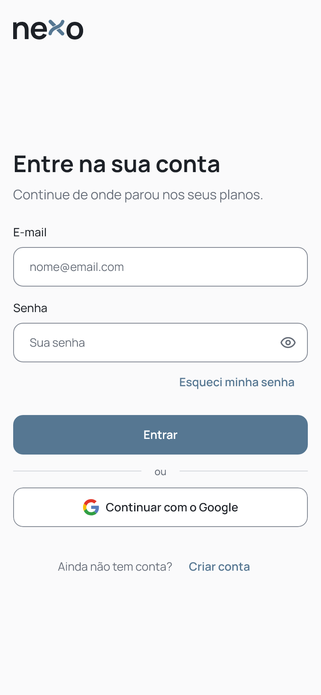 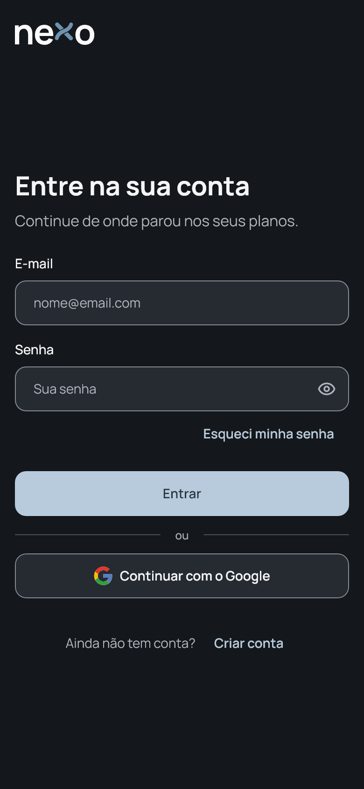 | 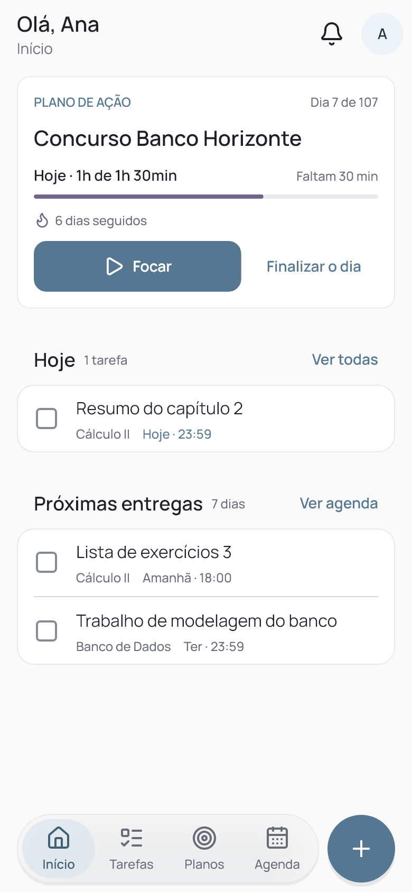 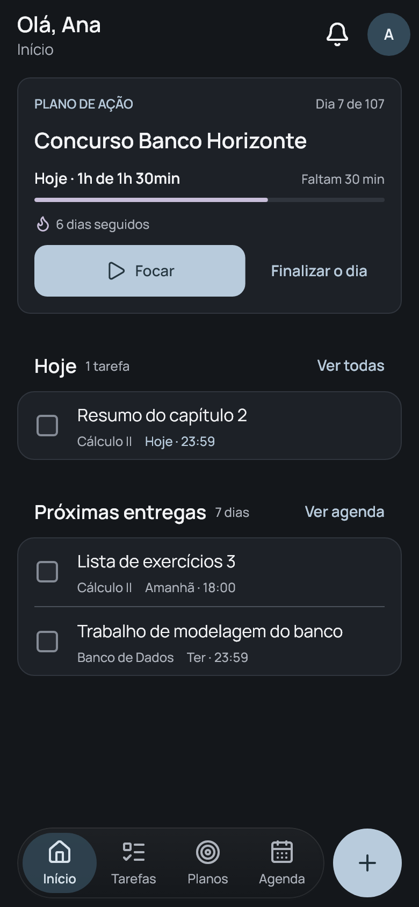 |
| **Tarefas** | **Agenda** |
| 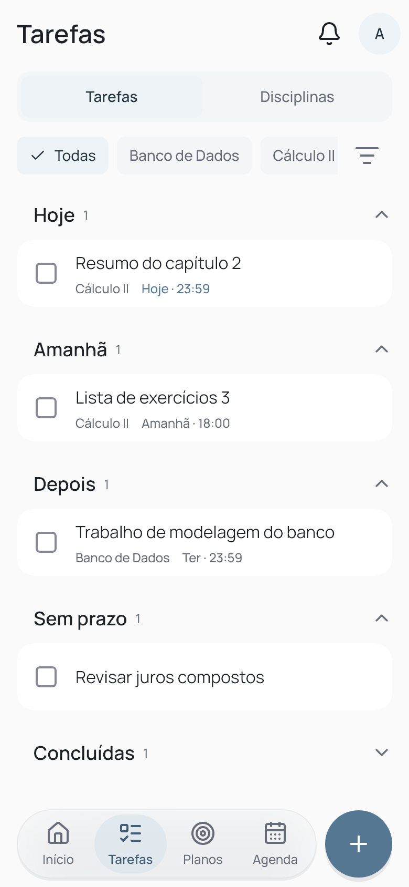 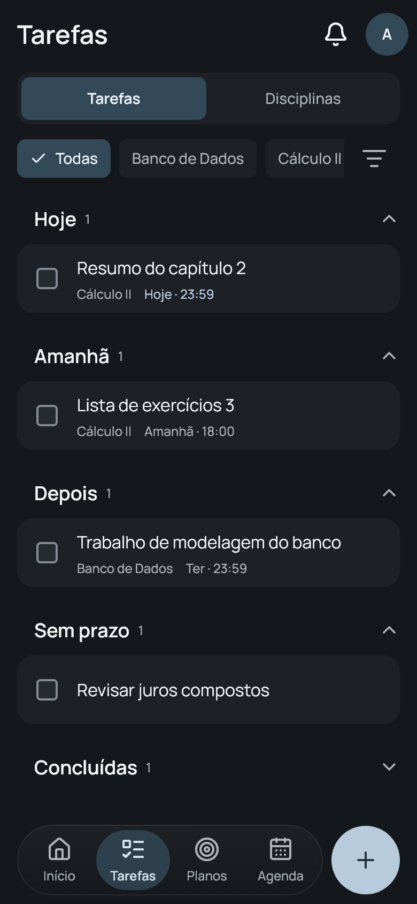 | 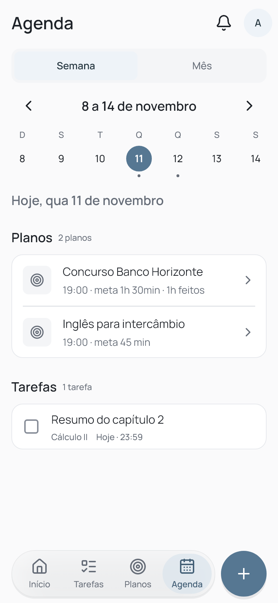 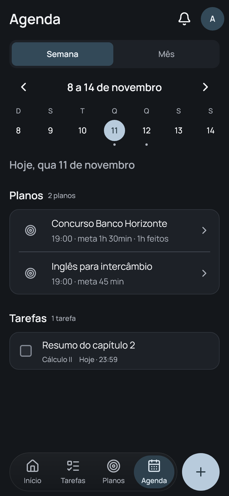 |
| **Plano de ação** | **Foco** |
| 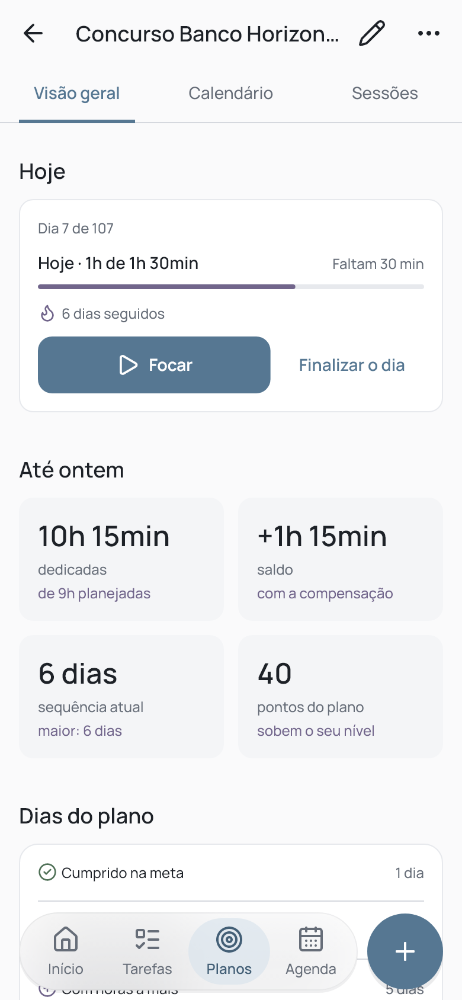 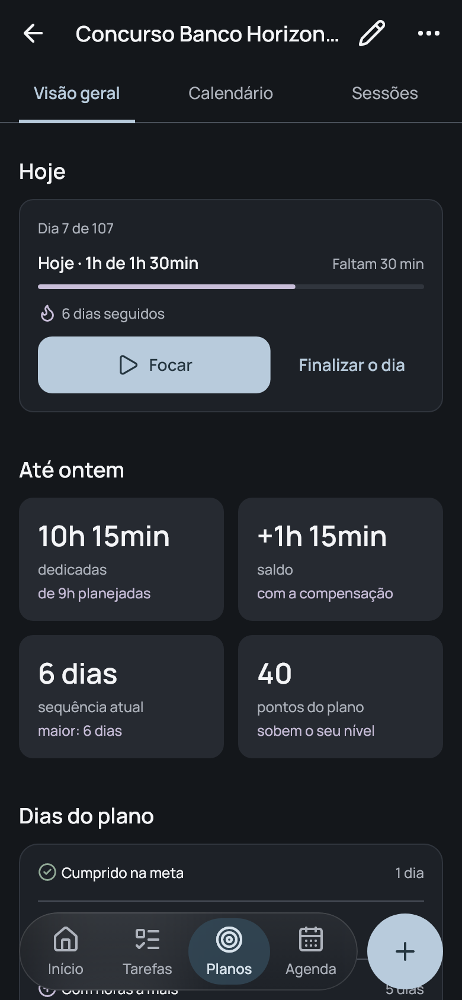 | 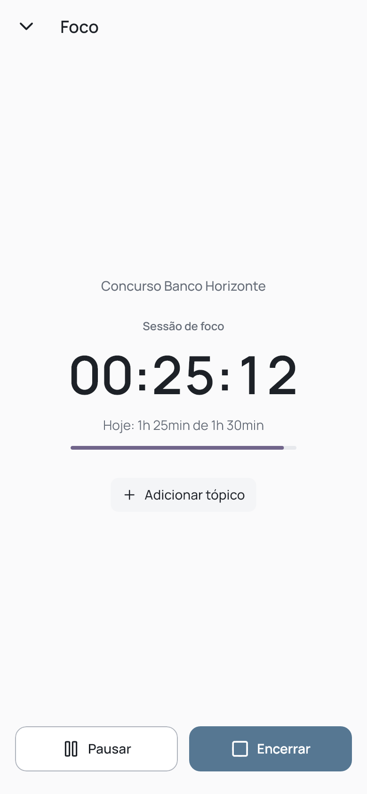 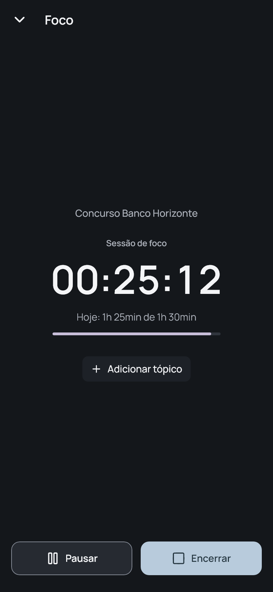 |
| **Perfil e progresso** | |
| 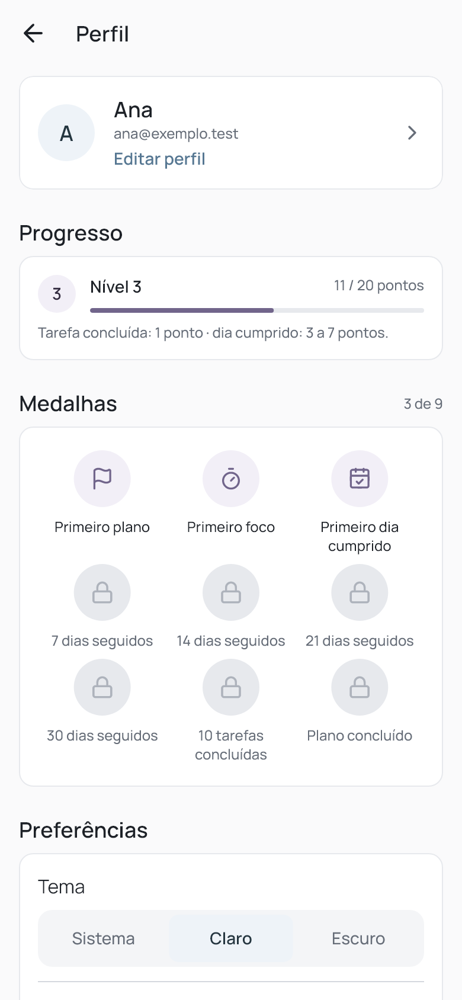 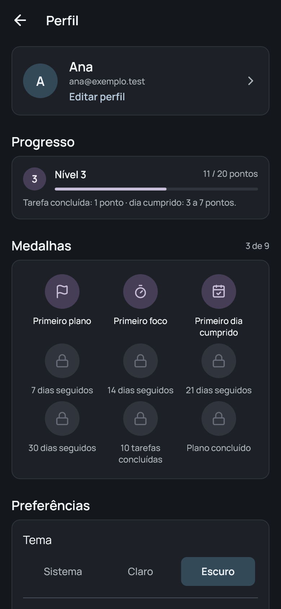 | |

---

## Parte técnica

### Stack

- **Flutter** 3.47 (Dart 3.13), Material 3 com um design system próprio (fonte Manrope e ícones Lucide).
- **Riverpod 3** para estado e injeção de dependências, **go_router** para a navegação.
- **Firebase:**
  - Authentication: e-mail e senha, e Google;
  - Cloud Firestore, com regras que validam campo a campo;
  - Crashlytics.
- Android (minSdk 24). Recursos nativos pequenos ("Não perturbe" do foco, notificação fixa, fuso do aparelho) vão por canais Kotlin próprios, sem pacotes extras.

### Arquitetura

- O código fica em `app/lib/`, dividido por funcionalidade (`features/`: auth, plans, tasks, focus, calendar, progress, profile…). Cada funcionalidade tem as camadas `data` (repositórios), `domain` (regras puras, testáveis sem Flutter), `application` (providers e ações) e `presentation` (telas).
- Os componentes visuais e os tokens do tema (cores, espaçamento, forma, elevação, movimento) ficam em `core/`. As telas usam só esses tokens, sem cor solta.
- Os dados ficam em `users/{uid}` no Firestore. O app grava no cache local na hora e sincroniza quando há conexão, então funciona sem internet. Metas, status do dia, pontos e sequências são calculados no próprio app, sem servidor próprio.

### Como rodar

Pré-requisitos: Flutter 3.47 ou mais novo e um aparelho ou emulador Android.

```bash
cd app
flutter pub get
flutter run
```

A configuração do Firebase para Android já está no repositório. O login com Google só funciona em builds cuja assinatura (SHA-1) esteja cadastrada no projeto do Firebase. O login com e-mail e senha funciona em qualquer build.

### Como testar

A partir de `app/`:

| Objetivo | Comando |
|---|---|
| Análise estática | `flutter analyze` |
| Todos os testes | `flutter test` |
| Testes sem as imagens de referência | `flutter test --exclude-tags golden` |
| Atualizar as imagens de referência | `flutter test --update-goldens test/goldens` |
| Gerar as imagens deste README | `flutter test --update-goldens tool/readme_screens_test.dart` |

Os testes cobrem:

- as regras de negócio (dias do plano, pontos, sequências);
- as telas, em tamanho de celular e com fonte ampliada;
- os dois temas;
- a acessibilidade (alvos de toque, rótulos, contraste);
- os repositórios do Firestore. Estes rodam contra um banco em memória, só nos testes, e conferem o que cada gravação manda.

---

© 2026 Emanoel Lima Barbosa. Todos os direitos reservados.
